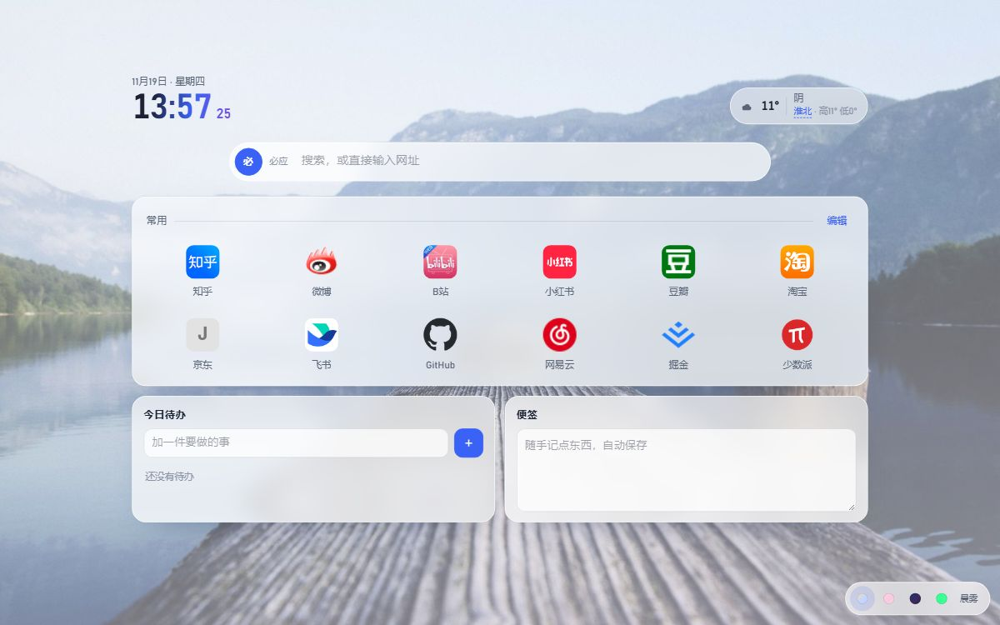

# 晨雾起始页 · Dawn Startpage

一个替代浏览器新标签页的起始页，带真实站点图标、整屏壁纸、天气、待办与便签。四套主题可切换，数据全部存在本地。



## 功能

- **搜索**：必应 / 百度 / Google 三引擎，点左侧圆钮切换；输入域名或 IP 时直接跳转
- **常用站点**：12 个默认站点，带官方 favicon；点「编辑」可增删改，支持上传名称与网址，存在本地
- **时间**：日期 + 时:分 + 秒
- **天气**：Open-Meteo 免费接口，自动定位到已选地点；点城市名可搜索任意地名，从候选里挑具体城市（同名地点可选），选定后记住经纬度
- **待办**：勾选完成、删除、显示进度
- **便签**：边打字边自动保存
- **主题**：晨雾 / 樱 / 夜幕 / 终端，右下角色点切换，壁纸随主题变化

基础数据都保存在浏览器本地（`localStorage`），不联网也能用搜索、站点、待办和便签；天气与壁纸需要联网，失败时自动退回渐变底色。

## 安装为浏览器扩展（推荐）

适用于 Chrome / Edge 等 Chromium 内核浏览器：

1. 打开 `chrome://extensions`（Edge 为 `edge://extensions`）
2. 打开右上角「开发者模式」
3. 点「加载已解压的扩展程序」，选择本仓库的 `extension/` 目录
4. 新标签页即被替换；不想用时停用或移除，新标签页恢复原样

## 直接当网页用

双击 `起始页.html` 即可在浏览器打开（需与 `assets/` 保持同目录才能显示图标）。若想让它当主页，可在浏览器设置里把「启动时」指向该文件的 `file://` 路径。

## 目录结构

```
.
├── 起始页.html          网页版，单文件（CSS/JS 全内联）
├── assets/              网页版用的站点图标
├── extension/           扩展版（Manifest V3）
│   ├── manifest.json
│   ├── newtab.html
│   ├── theme-init.js    首屏主题初始化，避免闪烁
│   ├── app.js           全部交互逻辑
│   ├── assets/          站点图标
│   └── icons/           扩展图标 16/32/48/128
└── screenshot/          README 用截图
```

网页版与扩展版内容一致，扩展版因为 Manifest V3 禁止内联脚本，把 JS 拆成了独立文件。

## 说明

- 站点图标为各站点官方 favicon，版权归各站点所有，仅作导航识别用
- 壁纸来自免费图源 [Picsum](https://picsum.photos)，天气与地名检索来自 [Open-Meteo](https://open-meteo.com)，均无需 API Key
- 未附带开源许可证；如需允许他人复用，可自行添加 MIT 等许可证文件
</content>
